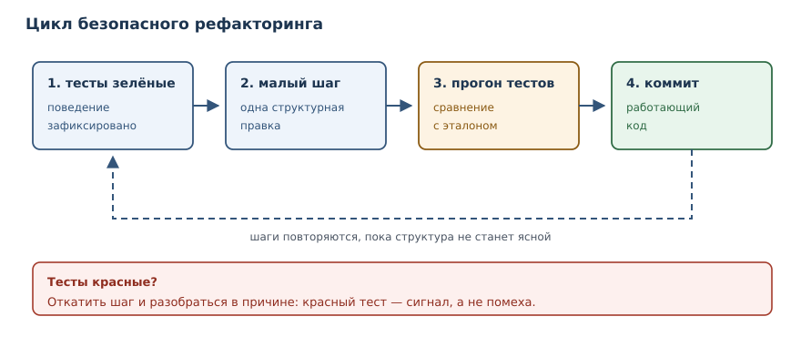
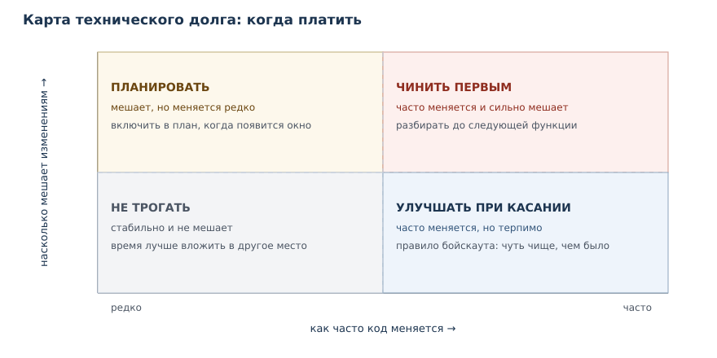

# Запахи кода, рефакторинг и сопровождение

<!-- syllanix:nav -->
**Навигация:** [← 52. Алгоритмическое мышление: сложность и выбор структур](52-complexity.md) · [Оглавление книги](../README.md) · [Далее: 54. Практикум: классические задачи и разбор решений →](54-practice.md)
<!-- /syllanix:nav -->

<!-- syllanix:topics -->
**Темы главы**
53.1. [Зачем это нужно](#why)  
53.2. [Что вы сможете после этой главы](#что-вы-сможете-после-этой-главы)  
53.3. [Запахи кода](#code-smells)  
53.4. [Рефакторинг](#refactoring)  
53.5. [Технический долг](#technical-debt)  
53.6. [Унаследованный код](#legacy)  
53.7. [Инциденты и разбор без виноватых](#incident)  
53.8. [Ревью изменений и когда рефакторить](#review)  
53.9. [Типичные ошибки](#mistakes)  
53.10. [Упражнения](#упражнения)  
53.11. [Проверка понимания](#проверка-понимания)  
53.12. [Связи и что дальше](#связи-и-что-дальше)  
<!-- /syllanix:topics -->


Программа почти никогда не остаётся такой, какой её написали. Требования
меняются, появляются новые сценарии, исправления наслаиваются на исправления.
Если структуру кода не поддерживать, изменения становятся всё дороже: чтобы
поправить одну строку, приходится читать сотню, а любая правка грозит сломать
что-то в другом месте. Эта глава о том, как замечать ранние признаки
деградации, как улучшать код, не меняя его поведения, и как сопровождать
систему, когда она уже работает у людей.

## Зачем это нужно {#why}

Представьте функцию, которая считает стоимость заказа. Сначала в ней было
пять строк. Потом добавили скидку для оптовых покупателей, затем особые
условия для VIP, затем доставку. Через год это двести строк с четырьмя
уровнями вложенности и числами вроде `0.93` без объяснений. Каждое следующее
изменение требует всё больше времени, а тесты покрывают только половину
ветвей.

Такая деградация не происходит из-за одного плохого решения. Она накапливается
из мелких компромиссов: «сейчас некогда, потом поправим». Потом не наступает,
и цена исправления растёт. Профессиональный подход состоит из трёх частей:
видеть признаки проблемы, устранять их малыми безопасными шагами и честно
учитывать, что именно осталось неисправленным.

## Что вы сможете после этой главы

Глава даёт практические критерии, а не только названия приёмов. К концу вы
будете уметь:

- узнавать типичные запахи кода и объяснять, чем каждый из них опасен;
- проводить рефакторинг так, чтобы поведение не менялось, и проверять это
  тестами;
- оценивать технический долг и решать, когда его платить;
- безопасно менять унаследованный код, начиная с тестов-характеристик;
- разбирать инцидент по хронологии и причинам, без поиска виноватых;
- проводить ревью изменений по короткому и конкретному чек-листу.

## Запахи кода {#code-smells}

**Запах кода** — признак в коде, который сигнализирует о возможной проблеме
проектирования: дублирование, длинные функции, магические числа.

Слово «запах» выбрано точно: он не доказывает дефект, но заставляет
присмотреться. Один и тот же приём в одном контексте нормален, в другом —
признак беды. Поэтому запах не приговор, а повод задать вопрос: почему код
выглядит так и что будет, когда его придётся менять.

| Запах | Как выглядит | Чем опасен |
|---|---|---|
| дублирование | одинаковые блоки в нескольких местах | правку нужно повторить везде, легко забыть |
| длинная функция | сотня строк и несколько задач внутри | трудно читать, тестировать и менять |
| магические числа | `0.93`, `86400` без имени | смысл неизвестен, значение легко перепутать |
| мёртвый код | функции и ветви, которые никто не вызывает | вводит в заблуждение и замедляет чтение |
| глубокая вложенность | четыре уровня `if` внутри цикла | ветви трудно удержать в голове |
| «класс-бог» | класс знает про всё и вызывается отовсюду | изменение задевает несвязанные части |
| флаговый аргумент | `send(text, True)` | из вызова непонятно, что означает флаг |
| пустой `except` | `except: pass` | ошибка исчезает молча, причина не видна |

Дублирование — самый частый и самый дорогой запах. Две похожие функции
выглядят безобидно, пока правило не изменится: тогда правку делают в одной,
забывают во второй, и поведение расходится.

```python exec
def total_for_user(items):
    result = 0
    for item in items:
        result += item["price"] * item["quantity"]
    if result > 1000:
        result = result * 0.9
    return result

def total_for_company(items):
    result = 0
    for item in items:
        result += item["price"] * item["quantity"]
    if result > 5000:
        result = result * 0.9
    return result

items = [{"price": 300, "quantity": 4}]
print(total_for_user(items))
print(total_for_company(items))
```

```output
1080.0
1200
```

Обе функции повторяют подсчёт суммы и правило скидки; различается только
порог. Устраним дублирование, выделив общую часть:

```python exec
def subtotal(items):
    return sum(item["price"] * item["quantity"] for item in items)

def total(items, *, discount_from):
    amount = subtotal(items)
    if amount > discount_from:
        return amount * 0.9
    return amount

items = [{"price": 300, "quantity": 4}]
print(total(items, discount_from=1000))
print(total(items, discount_from=5000))
```

```output
1080.0
1200
```

Поведение то же, но правило подсчёта теперь в одном месте. Порог стал
параметром только для именованных аргументов: вызов `total(items,
discount_from=1000)` читается как фраза, а не как последовательность
загадочных чисел.

### Как читать запах {#reading-smell}

Запах — не команда «переписать». Прежде чем что-то менять, ответьте на три
вопроса. Первый: как часто этот код меняется? Второй: насколько дорого
изменение именно из-за этого места? Третий: что сломается, если не трогать?

Если код стабилен и менять его не планируют, запах может остаться: время
лучше потратить там, где изменения происходят. Если же место меняется каждую
неделю и каждый раз причиняет боль, запах указывает на реальную проблему.
Отсюда правило: чинить стоит не то, что красиво выглядит в отчёте линтера, а
то, что мешает работе.



## Рефакторинг {#refactoring}

**Рефакторинг** — изменение внутренней структуры кода без изменения внешнего
поведения, выполняемое малыми проверяемыми шагами.

Три слова в определении принципиальны. «Структуры» — потому что меняется
устройство, а не возможности. «Без изменения поведения» — потому что
наблюдаемый результат должен остаться прежним: те же значения, те же ошибки,
тот же формат. «Малыми шагами» — потому что после каждого шага работающий код
должен оставаться работающим.

Страховка при рефакторинге — тесты. Если поведение зафиксировано, любое
изменение структуры можно проверить за секунды. В главе 32 вы познакомились с
модульными тестами, а в этой главе они становятся инструментом, без которого
рефакторинг превращается в риск.

Разберём типичный запах: флаговый аргумент вместе с магическими числами.

```python exec
def total(items, is_vip):
    result = 0
    for item in items:
        price = item["price"]
        if item["quantity"] > 3:
            price = price * 0.9
        if is_vip:
            price = price * 0.95
        result = result + price * item["quantity"]
    return result

items = [{"price": 100, "quantity": 5}, {"price": 50, "quantity": 1}]
print(total(items, False))
print(total(items, True))
```

```output
500.0
475.0
```

Проблемы видны сразу: `0.9` и `0.95` без объяснения, логика склеена в одну
функцию, а флаг `is_vip` делает вызов нечитаемым. Перепишем структуру, сохранив
поведение:

```python exec
BULK_QUANTITY = 3
BULK_DISCOUNT = 0.9
VIP_DISCOUNT = 0.95

def item_price(item, *, vip):
    price = item["price"]
    if item["quantity"] > BULK_QUANTITY:
        price *= BULK_DISCOUNT
    if vip:
        price *= VIP_DISCOUNT
    return price

def total(items, *, vip=False):
    return sum(item_price(item, vip=vip) * item["quantity"] for item in items)

items = [{"price": 100, "quantity": 5}, {"price": 50, "quantity": 1}]
print(total(items))
print(total(items, vip=True))
```

```output
500.0
475.0
```

Числа получили имена, расчёт цены одной позиции стал отдельной функцией с
понятной ответственностью, а флаг превратился в именованный аргумент со
значением по умолчанию. Вывод совпал — именно это и означает «поведение не
изменилось».

### Приёмы рефакторинга {#techniques}

Приёмы описывают конкретные шаги, из которых складывается безопасное
изменение. Вот те, что встречаются чаще всего:

- **извлечение функции** — фрагмент, который можно назвать по смыслу,
  становится функцией с понятным именем;
- **извлечение класса** — группа данных и функций переезжает в отдельный
  класс, когда у них появляется одна ответственность;
- **переименование** — имя приводит к смыслу: `data2` становится
  `unpaid_orders`;
- **устранение дублей** — общая часть выносится в одно место, различия
  становятся параметрами;
- **замена условия полиморфизмом** — цепочка `if kind == ...` превращается в
  подклассы или в отдельные функции обработки;
- **разделение фаз** — длинная функция делится на подготовку, обработку и
  вывод результата.

Покажем замену условия полиморфизмом. Такой код часто появляется при
добавлении новых видов сущностей:

```python exec
def salary(employee):
    if employee["kind"] == "manager":
        return employee["base"] + employee["bonus"]
    if employee["kind"] == "intern":
        return employee["base"] * 0.5
    return employee["base"]

staff = [
    {"name": "Аня", "kind": "manager", "base": 100, "bonus": 50},
    {"name": "Боря", "kind": "intern", "base": 100},
    {"name": "Вера", "kind": "staff", "base": 100},
]
for person in staff:
    print(person["name"], salary(person))
```

```output
Аня 150
Боря 50.0
Вера 100
```

Каждый новый вид сотрудника потребует правки этой функции и рискует сломать
существующие ветви. Вынесем правило в классы:

```python exec
class Employee:
    def __init__(self, name, base):
        self.name = name
        self.base = base

    def salary(self):
        return self.base

class Manager(Employee):
    def __init__(self, name, base, bonus):
        super().__init__(name, base)
        self.bonus = bonus

    def salary(self):
        return self.base + self.bonus

class Intern(Employee):
    def salary(self):
        return self.base * 0.5

staff = [Manager("Аня", 100, 50), Intern("Боря", 100), Employee("Вера", 100)]
for person in staff:
    print(person.name, person.salary())
```

```output
Аня 150
Боря 50.0
Вера 100
```

Теперь новый вид сотрудника — новый класс, а не новая ветвь в общей функции.
Цикл печати не знает о видах: он вызывает `salary` у каждого объекта. Вывод
снова совпал.

## Технический долг {#technical-debt}

**Технический долг** — накопленные компромиссы в коде и архитектуре, которые
повышают стоимость будущих изменений.

Метафора долга точна: быстрый компромисс сегодня похож на кредит. Сначала он
помогает успеть к сроку, потом начинает брать проценты — каждая следующая
правка требует больше времени, потому что код приходится читать внимательнее,
обходить стороной хрупкие места и повторять проверки вручную.

Долг возникает не только от лени. Чаще его причины такие: сроки, изменившиеся
требования, неполное понимание задачи, отсутствие тестов и спешка при
исправлении инцидента. Важно не то, что долг появился, — он появляется всегда.
Важно, чтобы он был виден и учитывался.

Измеряют долг косвенно, по признакам, которые легко собрать:

- **покрытие тестами** — низкое покрытие означает, что любое изменение
  опасно;
- **длина и вложенность функций** — код, который трудно прочитать, дороже
  менять;
- **объём дублирования** — чем больше копий, тем больше мест для правки;
- **число незакрытых пометок о доработках и известных дефектов**;
- **время до первого исправления** в незнакомом модуле — честная оценка на
  практике.

Простейшие метрики можно посчитать и без специальных инструментов:

```python exec
source = '''def f(a, b, c, d):
    if a:
        if b:
            if c:
                return d
'''

def metrics(text):
    lines = [line for line in text.splitlines() if line.strip()]
    depth = max((len(line) - len(line.lstrip())) // 4 for line in lines)
    return {"строк": len(lines), "вложенность": depth}

print(metrics(source))
```

```output
{'строк': 5, 'вложенность': 4}
```

Такая метрика не заменяет анализ, но помогает заметить рост: если вложенность
растёт от релиза к релизу, долг накапливается. Полезнее всего смотреть на
динамику, а не на абсолютные числа.



### Когда платить долг {#when-to-pay}

Долг платят не «когда-нибудь», а в конкретные моменты. Перед новой функцией —
если без чистки её некуда встроить. При исправлении дефекта — если он возник
из-за неясной структуры. При подготовке к релизу — если риск слишком высок.
Не платят, когда код стабилен и не мешает: время лучше вложить туда, где
изменения действительно происходят.

## Унаследованный код {#legacy}

**Унаследованный код** — код, который сложно менять: нет тестов, устарели
зависимости, неясны требования; требует особой стратегии работы.

Главная ошибка при встрече с таким кодом — переписать всё с нуля. Полная
переделка означает потерять накопленные знания о поведении: в старом коде
зашиты исправления реальных инцидентов, странные проверки и договорённости,
о которых нет документации. Новый код будет «чище», но в первое время —
неправильнее.

Правильная стратегия начинается с фиксации текущего поведения. Тесты,
которые закрепляют существующее поведение, даже если оно странное, называют
тестами-характеристиками. Они не судят о правильности, а описывают, как
система работает сейчас.

```python exec
def legacy_items(text):
    return text.split(",")

def characterize():
    cases = {"a, b": ["a", " b"], "a,,b": ["a", "", "b"], "": [""]}
    for text, expected in cases.items():
        assert legacy_items(text) == expected, text
    print("характеристика зафиксирована:", len(cases), "случая")

characterize()
```

```output
характеристика зафиксирована: 3 случая
```

Тест зафиксировал три важные детали: пробел в начале второго элемента не
убирается, пустой элемент сохраняется, пустая строка даёт один пустой
элемент. Теперь можно менять внутреннюю реализацию, пока эти свойства
сохраняются. Если какое-то из них в будущем понадобится изменить, это будет
осознанное решение, а не случайность.

Дальше работа идёт малыми шагами: изолировать участок, покрыть его тестами,
улучшить структуру, перейти к следующему. Если у кода нет швов — мест, где
поведение можно подменить в тесте, — сначала вводят простые зависимости через
параметры конструктора, а не глобальные объекты.

## Инциденты и разбор без виноватых {#incident}

**Инцидент** — событие, нарушившее работу системы; расследуется по логам,
метрикам и хронологии изменений.

Инциденты случаются у всех, включая аккуратные команды. Разница в том, как
команда на них реагирует. Поиск виноватого почти всегда вредит: люди
перестают сообщать о проблемах, а настоящая причина остаётся. Поэтому
современная практика — **разбор инцидента** без поиска виноватых: собрать
хронологию, понять механизм, найти меры.

Работает это так. Сначала восстанавливают хронологию: что произошло в какое
время, какие изменения вышли, что показывали метрики и логи. Затем задают
вопрос «почему» несколько раз, пока не доходят до системной причины. Потом
формулируют меры: что изменить в коде, тестах, мониторинге или процессе.
Мера должна быть проверяемой, иначе разбор превращается в обещания.

Типичный пример скрытой причины — изменяемое значение по умолчанию:

```python exec
class Cart:
    def __init__(self, items=[]):
        self.items = items

a = Cart()
b = Cart()
a.items.append("книга")
print(b.items)
```

```output
['книга']
```

На первый взгляд каждая корзина создаёт свой список. На самом деле значение
по умолчанию создаётся один раз, при определении функции, и все экземпляры
делят один и тот же список. Дальше достаточно одного заказа, чтобы испортить
корзины всех пользователей в том же процессе. Пять «почему» выглядят так:
почему корзины пусты у других? потому что список общий; почему он общий?
потому что значение по умолчанию одно на всех; почему так написано? потому
что список хотели сделать необязательным; почему это не заметили? потому что
тест создавал один объект; почему тест создавал один? потому что проверяли
один сценарий. Системная мера — не «быть внимательнее», а запрет изменяемых
значений по умолчанию и тест на два экземпляра.

```python exec
class Cart:
    def __init__(self, items=None):
        self.items = [] if items is None else list(items)

a = Cart()
b = Cart()
a.items.append("книга")
print(b.items)
print(a.items)
```

```output
[]
['книга']
```

Разбор инцидента полезно связать с мониторингом из главы 45: без метрик и
логов хронология восстанавливается по воспоминаниям. И ещё одно правило —
разбор пишут в тот же день или на следующий, пока детали свежи, а не через
месяц, когда восстановить последовательность уже невозможно.

## Ревью изменений и когда рефакторить {#review}

Ревью кода из главы 45 проверяет не только синтаксис. Короткий чек-лист,
который ловит большинство проблем:

- изменение делает одну вещь, и его можно описать одним предложением;
- тесты покрывают новое поведение и не сломались старые;
- нет скопированного блока, который стоило бы вынести;
- нет чисел без имён и флагов без пояснения в вызове;
- ошибки не проглатываются пустым `except`;
- если структура ухудшилась, это зафиксировано как долг с планом.

Когда рефакторить? Есть два надёжных ориентира. Первый — правило бойскаута:
оставлять код чуть чище, чем он был до вашего изменения; небольшие улучшения
почти ничего не стоят. Второй — подготовка к функции: если новая возможность
плохо встраивается в текущую структуру, сначала меняют структуру, потом
добавляют функцию. Так делают две отдельные правки: одну по поведению, вторую
по устройству. Смешивать их в одном изменении опасно, потому что при
отладке непонятно, что именно сломало поведение.

## Типичные ошибки {#mistakes}

1. **Рефакторинг без тестов.** Если поведение не зафиксировано, вы не
   отличите улучшение от дефекта.
2. **Большой шаг вместо малого.** Изменение на тысячу строк невозможно
   проверить, и откатить его тоже нельзя.
3. **Смешивание рефакторинга с новой функциональностью.** Две цели в одном
   изменении мешают и ревью, и отладке.
4. **Погоня за запахами.** Чинить всё, что подсказывает линтер, бессмысленно:
   важнее места, которые действительно меняются.
5. **Переписывание унаследованного кода с нуля.** Теряются неявные знания о
   поведении, а новый код повторяет старые ошибки.
6. **Пустой `except`.** Ошибка исчезает, и её причина остаётся неизвестной,
   пока не случится инцидент.
7. **Разбор инцидента с поиском виноватого.** Люди начинают скрывать
   проблемы, а системные причины не находятся.

## Упражнения

### 1. Прогноз вывода {#ex-ch53-01}

Определите, что напечатает программа, и объясните, изменится ли вывод после
устранения дублирования:

```python
def total_for_user(items):
    result = 0
    for item in items:
        result += item["price"] * item["quantity"]
    if result > 1000:
        result = result * 0.9
    return result

def total_for_company(items):
    result = 0
    for item in items:
        result += item["price"] * item["quantity"]
    if result > 5000:
        result = result * 0.9
    return result

items = [{"price": 300, "quantity": 4}]
print(total_for_user(items))
print(total_for_company(items))
```

### 2. Извлечение функции {#ex-ch53-02}

Функция считает итог и печатает его. Разделите её на расчёт и печать так,
чтобы вывод не изменился. Проверьте на двух наборах товаров.

```text
def report(items):
    result = 0
    for item in items:
        result += item["price"] * item["quantity"]
    if result > 1000:
        result = result * 0.9
    print("Итого:", round(result, 2))
```

### 3. Магические числа {#ex-ch53-03}

В функции зашиты числа `3`, `0.9` и `0.95`. Замените их именованными
константами и проверьте, что вывод для тех же данных не изменился.

### 4. Флаговый аргумент {#ex-ch53-04}

Вызов `send(text, True)` непонятен читателю. Переделайте интерфейс так, чтобы
режим передавался именованным аргументом, и проверьте, что результат прежний.

```text
def send(text, urgent):
    if urgent:
        return "срочно: " + text
    return text
```

### 5. Устранение дублирования {#ex-ch53-05}

Две функции почти одинаковы: различается только порог скидки. Сведите их к
одной функции с параметром и покажите, что результаты для обоих случаев
сохранились.

### 6. Замена условия полиморфизмом {#ex-ch53-06}

Цепочка `if kind == ...` вычисляет скорость доставки. Замените её классами с
общим интерфейсом и проверьте, что результаты для трёх видов совпадают.

```text
def speed(kind):
    if kind == "bike":
        return 15
    if kind == "car":
        return 60
    return 5
```

### 7. Пустой except {#ex-ch53-07}

Функция молча возвращает `None` при ошибке разбора. Исправьте так, чтобы
ошибка поднималась с понятным сообщением, и проверьте оба случая.

```text
def parse_age(text):
    try:
        return int(text)
    except ValueError:
        pass
```

### 8. Тест-характеристика {#ex-ch53-08}

Унаследованная функция `legacy_items(text)` делит строку по запятой и
сохраняет пустые элементы. Напишите тест-характеристику для трёх случаев,
включая пустую строку, и объясните, зачем он нужен перед рефакторингом.

### 9. Разбор инцидента {#ex-ch53-09}

Корзины пользователей начали «делиться» товарами. Воспроизведите причину,
объясните её цепочкой «почему» и предложите две меры: в коде и в тестах.

### 10. Мини-проект: рефакторинг отчёта {#ex-ch53-10}

Функция `report` собирает строки, считает итог и печатает чек. Разделите её на
три функции, проверьте совпадение вывода до и после, посчитайте длину функций
до и после и объясните, что изменилось в стоимости будущих правок.

## Проверка понимания

1. Чем запах кода отличается от дефекта и почему не всякий запах нужно
   устранять?
2. Что означает «поведение не изменилось» при рефакторинге и как это
   проверить?
3. Почему рефакторинг делают малыми шагами?
4. Как технический долг связан со стоимостью будущих изменений?
5. Зачем нужны тесты-характеристики в унаследованном коде?
6. Почему разбор инцидента проводят без поиска виноватых?

## Связи и что дальше

Рефакторинг опирается на тесты из главы
[«Тестирование: pytest и TDD»](32-testing.md) и на приёмы проектирования из
глав [«Проектирование классов и API»](30-oop-design.md) и
[«Архитектура, SOLID и паттерны»](44-architecture.md). Разбор инцидентов
связан с мониторингом из главы
[«Git, CI, релизы и сопровождение»](45-git-ci-releases.md) и с
логированием из главы [«Время, даты и логирование»](37-time-logging.md):
без метрик и логов хронология восстанавливается по памяти.

Дальше — практикум: в следующей главе классические задачи разбираются от
декомпозиции до готового решения, и приёмы этой главы понадобятся там
постоянно, потому что любое решение удобно улучшать, когда оно проверено
тестами.

<!-- syllanix:nav -->
**Перед этой главой:** [52. Алгоритмическое мышление: сложность и выбор структур](52-complexity.md)
**Связанные главы:** [03. Значения, имена, объекты и типы](03-values-names-objects.md), [07. Функции: параметры, аргументы и области видимости](07-functions.md), [10. Ошибки и исключения](10-errors-exceptions.md), [13. Списки: индексы, срезы и методы](13-lists.md), [15. Строки: методы, форматирование и Unicode](15-strings.md), [17. Словари: отображения и структурирование данных](17-dicts.md), [18. Ссылки, алиасы и копирование](18-references-copy.md), [24. Гибкие сигнатуры: *args, **kwargs и распаковка](24-signatures.md)
**Далее:** [54. Практикум: классические задачи и разбор решений →](54-practice.md)
<!-- /syllanix:nav -->
