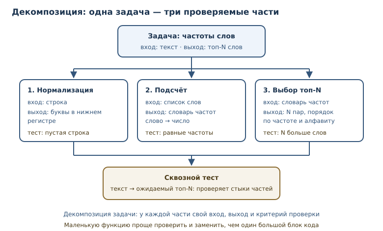
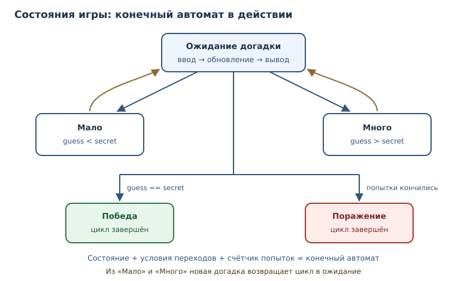

# Практикум: классические задачи и разбор решений

<!-- syllanix:nav -->
**Навигация:** [← 53. Запахи кода, рефакторинг и сопровождение](53-refactoring.md) · [Оглавление книги](../README.md) · [Далее: 55. Графический интерфейс на tkinter →](55-tkinter.md)
<!-- /syllanix:nav -->

<!-- syllanix:topics -->
**Темы главы**
54.1. [Что вы сможете после этой главы](#что-вы-сможете-после-этой-главы)  
54.2. [Как решать незнакомую задачу](#method)  
54.3. [1. FizzBuzz: порядок условий](#fizzbuzz)  
54.4. [2. Ханойская башня: рекурсия и индукция](#hanoi)  
54.5. [3. Палиндром и скобочная последовательность](#stack)  
54.6. [4. «Угадай число»: игровой цикл и конечный автомат](#game)  
54.7. [5. Collatz: while, границы и честность](#collatz)  
54.8. [6. Шифр Цезаря: строки и обратимость](#caesar)  
54.9. [7. От требований к тестам](#requirements)  
54.10. [Типичные ошибки на практикумах](#mistakes)  
54.11. [Упражнения](#упражнения)  
54.12. [Проверка понимания](#проверка-понимания)  
54.13. [Что дальше](#что-дальше)  
<!-- /syllanix:topics -->


Умение писать код складывается не из знания синтаксиса, а из опыта решения
задач. И здесь важно не «увидеть правильный ответ», а научиться получать его
самому: понимать условие, находить идею, проверять границы и доказывать, что
решение работает.

Эта глава — практикум. В ней семь классических задач, каждая разобрана
целиком: постановка своими словами, идея, код, сложность, граничные случаи и
вывод о том, что именно она тренирует. Общие приёмы — **декомпозиция задачи**,
**проектирование алгоритма**, **конечный автомат** и **игровой цикл** — вы
увидите в действии, а не в виде определений.

## Что вы сможете после этой главы

К концу главы у вас будет рабочий метод решения незнакомых задач и разбор
семи типовых сюжетов, на которых этот метод удобно тренировать. Вы сможете:

- разбивать задачу на подзадачи с ясными входами и выходами;
- выбирать между перебором, рекурсией и моделированием состояний;
- оценивать сложность и объяснять, почему решение не «зависнет»;
- находить граничные случаи до запуска кода;
- превращать требования в набор тестов и проверять реализацию.

## Как решать незнакомую задачу {#method}

У опытного программиста нет «озарений» — есть последовательность шагов.
Пять из них закрывают большинство учебных и рабочих задач.

1. **Понять вход и выход.** Что подаётся на вход: число, строка, список,
   поток данных? Что требуется вернуть: значение, новую структуру, строки
   вывода? Что считается ошибкой входа?
2. **Разобрать примеры.** Возьмите два-три примера, включая пустой и
   граничный. Если условие неоднозначно, примеры вскроют это раньше кода.
3. **Разбить на подзадачи.** **Декомпозиция задачи** — разбиение задачи на
   подзадачи с ясными входами, выходами и критериями проверки. Вместо одной
   большой функции появляется несколько маленьких, каждую из которых можно
   проверить отдельно.
4. **Проверить на бумаге.** Прогоните идею вручную на маленьком примере.
   Так вы найдёте ошибку до того, как напишете код, и поймёте, какие
   переменные понадобятся.
5. **Написать тест и только потом реализацию.** **Проектирование алгоритма**
   — построение решения: выбор стратегии (перебор, рекурсия, динамическое
   программирование), оценка сложности и проверка на примерах. Тест фиксирует
   договорённость о поведении и не даёт подогнать решение под случайный
   результат.



Полезно сразу оценить масштаб. Если вход размером `n`, а внутри двойной цикл
по всем элементам, получится квадратичный рост — при больших `n` решение
может не уложиться во время. Оценка сложности не требует точной формулы:
достаточно понять, сколько раз в зависимости от `n` выполняется основной цикл.
Подробнее об этом — в [главе 52](52-complexity.md).

## 1. FizzBuzz: порядок условий {#fizzbuzz}

**Постановка.** Для чисел от 1 до `n` выведите строку: `Fizz`, если число
делится на 3; `Buzz`, если делится на 5; `FizzBuzz`, если делится и на 3,
и на 5; иначе само число.

**Идея.** Каждое число проверяется независимо, поэтому достаточно одного
цикла. Главная тонкость — порядок проверок: условие «делится и на 3, и на 5»
должно стоять первым, иначе более общие ветки перехватят его.

```python exec
def fizzbuzz(limit: int) -> list[str]:
    result: list[str] = []
    for number in range(1, limit + 1):
        if number % 3 == 0 and number % 5 == 0:
            result.append("FizzBuzz")
        elif number % 3 == 0:
            result.append("Fizz")
        elif number % 5 == 0:
            result.append("Buzz")
        else:
            result.append(str(number))
    return result


print(fizzbuzz(15))
```

```output
['1', '2', 'Fizz', '4', 'Buzz', 'Fizz', '7', '8', 'Fizz', 'Buzz', '11', 'Fizz', '13', '14', 'FizzBuzz']
```

**Типичные ошибки.** Первая — проверить `% 3`, затем `% 5`, а `FizzBuzz` не
предусмотреть вовсе: число 15 получит `Fizz`. Вторая — написать три отдельных
`if` без `elif`: строка может быть добавлена несколько раз. Третья —
возвращать числа как числа, а строки как строки, получая список смешанных
типов. Четвёртая — забыть, что диапазон начинается с 1, а не с 0.

**Сложность и границы.** Время `O(n)`, память `O(n)`, если собирать список;
при печати по одному память `O(1)`. Границы: `n = 0` даёт пустой список,
`n < 0` — тоже пустой; стоит ли это ошибкой, решает условие задачи.

**Что тренирует.** Порядок проверок, остаток от деления, аккуратность с
типами и границами диапазона.

## 2. Ханойская башня: рекурсия и индукция {#hanoi}

**Постановка.** Есть три стержня (`A`, `B`, `C`) и `n` дисков разного
размера на первом. Нужно перенести все диски на третий, перемещая по одному
диску за раз и не кладя больший диск на меньший. Требуется перечислить ходы
или хотя бы посчитать их число.

**Идея.** Рекурсия строится на индукции. Чтобы перенести `n` дисков с `A` на
`C`, нужно: перенести `n−1` дисков с `A` на вспомогательный `B`, переместить
самый большой диск с `A` на `C`, затем перенести `n−1` дисков с `B` на `C`.
База — `n = 0`: ничего делать не нужно.

```python exec
def hanoi_moves(n: int, source: str = "A", target: str = "C", spare: str = "B") -> list[tuple[str, str]]:
    if n == 0:
        return []
    return (
        hanoi_moves(n - 1, source, spare, target)
        + [(source, target)]
        + hanoi_moves(n - 1, spare, target, source)
    )


moves = hanoi_moves(3)
print(len(moves))
print(moves[:3])
print(len(hanoi_moves(10)))
```

```output
7
[('A', 'C'), ('A', 'B'), ('C', 'B')]
1023
```

**Вывод числа ходов.** Каждый вызов делает два рекурсивных вызова и один ход:
`T(n) = 2T(n−1) + 1`, `T(0) = 0`. Решение — `T(n) = 2ⁿ − 1`: для десяти
дисков 1023 хода, для шестидесяти — больше, чем атомов в наблюдаемой
Вселенной. Это пример экспоненциальной сложности `O(2ⁿ)`, а не «медленного
компьютера».

**Границы.** `n = 0` — пустой список; отрицательное `n` по смыслу неверно и
должно приводить к ошибке, а не к бесконечной рекурсии. Для больших `n`
сработает ограничение глубины рекурсии: список ходов тоже не поместится в
память. Рекурсию здесь можно заменить явным стеком, но выигрыша по сложности
не будет.

**Что тренирует.** Рекурсию, базовый случай, индуктивное рассуждение и
понимание того, что экспоненциальный рост — свойство задачи, а не языка.

## 3. Палиндром и скобочная последовательность {#stack}

**Постановка.** Проверить, читается ли строка одинаково в обе стороны
(палиндром), игнорируя регистр и знаки препинания. Отдельно — проверить,
правильно ли расставлены скобки `()`, `[]`, `{}` в выражении.

**Идея для палиндрома.** Сначала нормализация: оставить только буквы и
привести их к нижнему регистру. Затем два указателя сходятся к середине,
сравнивая символы.

```python exec
def normalize(text: str) -> str:
    return "".join(ch.lower() for ch in text if ch.isalpha())


def is_palindrome(text: str) -> bool:
    clean = normalize(text)
    return clean == clean[::-1]


print(is_palindrome("А роза упала на лапу Азора"))
print(is_palindrome("Привет"))
print(is_palindrome(""))
```

```output
True
False
True
```

**Идея для скобок.** Здесь нужен стек: открывающая скобка кладётся сверху,
закрывающая должна совпасть с последней открытой. Если в конце стек не пуст
или закрывающая пришла к пустому стеку — последовательность неверна.

```python exec
PAIRS = {")": "(", "]": "[", "}": "{"}
OPENING = "([{"


def is_balanced(text: str) -> bool:
    stack: list[str] = []
    for char in text:
        if char in OPENING:
            stack.append(char)
        elif char in PAIRS:
            if not stack or stack.pop() != PAIRS[char]:
                return False
    return not stack


for sample in ["([]{})", "(]", "([)]", ""]:
    print(repr(sample), is_balanced(sample))
```

```output
'([]{})' True
'(]' False
'([)]' False
'' True
```

**Типичные ошибки.** Для палиндрома — забыть нормализацию или нормализовать
не полностью: тогда `"А роза..."` не совпадёт сама с собой. Для скобок —
проверять только количество скобок, а не порядок: `"([)]"` содержит по паре
каждого вида, но неверна. Ещё одна ошибка — не обработать пустой стек перед
`pop`.

**Сложность.** Обе задачи линейны: `O(n)` по времени, `O(n)` памяти в худшем
случае (стек или нормализованная строка). Сравнение двух указателей можно
сделать без копии строки, если нормализовать «на лету».

**Что тренирует.** Работу со строками и индексами, идею стека как
«последним пришёл — первым вышел», проверку границ.

## 4. «Угадай число»: игровой цикл и конечный автомат {#game}

**Постановка.** Программа загадывает число от 1 до 100. Игрок вводит
догадки; программа сообщает «больше», «меньше» или «угадал». Игра
заканчивается победой или после фиксированного числа попыток.

**Идея.** Это **конечный автомат**: у игры есть состояния и правила перехода
между ними. Состояния: ожидание догадки, «загаданное больше», «загаданное
меньше», победа, поражение. **Игровой цикл** — цикл, который повторяет
чтение ввода, обновление состояния и отрисовку, поддерживая интерактивность.

В учебном примере ввод заменён списком догадок: так результат детерминирован
и проверяем.

```python exec
def play_guess(secret: int, guesses: list[int], max_attempts: int = 5) -> tuple[str, int]:
    attempts = 0
    for guess in guesses:
        attempts += 1
        if attempts > max_attempts:
            return "поражение", max_attempts
        if guess < secret:
            state = "больше"
        elif guess > secret:
            state = "меньше"
        else:
            return "победа", attempts
        print(f"попытка {attempts}: {guess} — загаданное {state}")
    return "не завершено", attempts


print(play_guess(42, [50, 25, 37, 42]))
print(play_guess(42, [10, 20, 30, 40, 50, 60]))
```

```output
попытка 1: 50 — загаданное меньше
попытка 2: 25 — загаданное больше
попытка 3: 37 — загаданное больше
('победа', 4)
попытка 1: 10 — загаданное больше
попытка 2: 20 — загаданное больше
попытка 3: 30 — загаданное больше
попытка 4: 40 — загаданное больше
попытка 5: 50 — загаданное меньше
('поражение', 5)
```

**Почему цикл обязан завершаться.** У цикла три выхода: победа, исчерпание
попыток, конец входных данных. Если забыть хотя бы один, игра может зависнуть
в ожидании. В интерактивной версии добавляется четвёртый выход — команда
«выход». Явное перечисление выходов и есть проектирование состояний.

**Границы.** Пустой список догадок даёт «не завершено»; `max_attempts = 0`
сразу приводит к поражению. Секрет вне диапазона — ошибка входных данных, её
лучше проверять до цикла.

**Что тренирует.** `while`/`for` с несколькими выходами, счётчик попыток,
моделирование состояний и дисциплину завершения цикла.

## 5. Collatz: while, границы и честность {#collatz}

**Постановка.** Для положительного целого `n` постройте последовательность:
если `n` чётно, разделите на 2; если нечётно — умножьте на 3 и прибавьте 1.
Повторяйте, пока не получится 1. Посчитайте число шагов.

**Идея.** Простой `while` с двумя ветками. Важно не перепутать порядок: для
нечётного числа `3n + 1` всегда чётно, но это не повод объединять шаги.

```python exec
def collatz_steps(start: int) -> int:
    if start < 1:
        raise ValueError("нужно положительное целое")
    number = start
    steps = 0
    while number != 1:
        number = number // 2 if number % 2 == 0 else 3 * number + 1
        steps += 1
    return steps


print([collatz_steps(n) for n in range(1, 11)])
print(max(range(1, 100), key=collatz_steps))
```

```output
[0, 1, 7, 2, 5, 8, 16, 3, 19, 6]
97
```

**Границы и честность.** `n = 1` даёт 0 шагов — цикл не выполняется ни разу.
`n ≤ 0` — ошибка: для нуля последовательность зациклится на 0, для
отрицательных правило не определено. Отдельно стоит сказать о гипотезе
Коллатца: неизвестно, завершается ли последовательность для **всех**
положительных чисел. Наш код честно работает для проверенных значений, но
доказательства завершения в общем случае у человечества нет. Это хороший
пример различия между «работает на моих тестах» и «доказано».

**Сложность.** Число шагов не имеет известной формулы; оценивают эмпирически.
Внутри шага — константное число операций, память `O(1)`.

**Что тренирует.** `while` с условием на состоянии, обработку неверного
входа, аккуратность в утверждениях о завершении.

## 6. Шифр Цезаря: строки и обратимость {#caesar}

**Постановка.** Зашифровать текст сдвигом каждой латинской буквы на `k`
позиций по кругу, не трогая регистр и остальные символы. Расшифровка —
тот же сдвиг в обратную сторону.

**Идея.** Для буквы берём её код через `ord`, вычитаем код `a` или `A`,
прибавляем сдвиг, берём остаток по модулю 26 и возвращаем букву через `chr`.
Остаток по модулю и обеспечивает «кольцо» алфавита.

```python exec
def caesar(text: str, shift: int) -> str:
    result: list[str] = []
    for char in text:
        if "a" <= char <= "z":
            code = (ord(char) - ord("a") + shift) % 26
            result.append(chr(code + ord("a")))
        elif "A" <= char <= "Z":
            code = (ord(char) - ord("A") + shift) % 26
            result.append(chr(code + ord("A")))
        else:
            result.append(char)
    return "".join(result)


secret = caesar("Python 3.14 — это здорово!", 13)
print(secret)
print(caesar(secret, 13))
```

```output
Clguba 3.14 — это здорово!
Python 3.14 — это здорово!
```

**Почему это обратимо.** Сдвиг на `k` — перестановка букв; обратная
перестановка — сдвиг на `26 − k`. Для ROT13 (`k = 13`) обратная операция
совпадает с прямой: два применения возвращают исходный текст.

**Типичные ошибки.** Применить сдвиг к кириллице или цифрам и получить
нечитаемый набор символов; забыть про верхний регистр; использовать `% 26`
для кода символа целиком, а не для позиции в алфавите. Последняя ошибка
особенно коварна: код заглавной и строчной буквы различается, и «единый»
модуль даёт разные результаты.

**Сложность.** `O(n)` по времени и памяти; операция над каждым символом
константна.

**Что тренирует.** Работу с кодами символов, остаток по модулю, обратимость
преобразований и внимание к диапазонам.

## 7. От требований к тестам {#requirements}

**Постановка.** Дан текст. Нужно вернуть `N` самых частых слов с количеством
вхождений. Требования нужно уточнить: регистр не важен; слова — только буквы;
при равенстве частот порядок алфавитный; пустой текст даёт пустой результат.

**Декомпозиция.** Задача распадается на три подзадачи с ясными контрактами:

| Подзадача | Вход | Выход |
|---|---|---|
| нормализация | строка | строка в нижнем регистре |
| разбиение | строка | список слов |
| подсчёт и выбор | список слов | список пар `(слово, число)` |

```python exec
import re


def words(text: str) -> list[str]:
    return re.findall(r"[а-яёa-z]+", text.lower())


def top_words(text: str, limit: int = 3) -> list[tuple[str, int]]:
    counts: dict[str, int] = {}
    for word in words(text):
        counts[word] = counts.get(word, 0) + 1
    return sorted(counts.items(), key=lambda item: (-item[1], item[0]))[:limit]


print(top_words("Кот и пёс. Кот спит, а пёс ест. Кот ест."))

assert top_words("") == []
assert top_words("Кот кот КОТ") == [("кот", 3)]
assert top_words("б а б", limit=2) == [("б", 2), ("а", 1)]
print("тесты прошли")
```

```output
[('кот', 3), ('ест', 2), ('пёс', 2)]
тесты прошли
```

Сортировка по ключу `(-count, word)` задаёт сразу два правила: сначала по
убыванию частоты, при равенстве — по алфавиту. Без второго правила порядок
зависел бы от порядка вставки, и тест «прыгал» бы при изменении текста.

**Тестовые случаи** стоит выбирать по риску: пустая строка, текст из одного
слова, слова в разном регистре, равные частоты, `limit` больше числа
уникальных слов. Каждый случай проверяет своё требование, а не «всё сразу».

**Что тренирует.** Превращение размытого требования в контракт, декомпозицию,
подбор тестов и аккуратную сортировку по нескольким ключам.



## Типичные ошибки на практикумах {#mistakes}

1. **Начинать с кода.** Без понятых входа, выхода и примеров решение почти
   всегда уходит не туда.
2. **Игнорировать границы.** Пустой ввод, ноль, отрицательные числа и
   максимальные значения ломают больше решений, чем сложные алгоритмы.
3. **Проверять условия не в том порядке.** FizzBuzz и обработка скобок
   чувствительны к порядку веток.
4. **Забыть выход из цикла.** Игра или поиск должны завершаться при любом
   допустимом вводе; перечислите все выходы заранее.
5. **Подгонять тест под результат.** Если тест написан после кода и
   «подкручен», он закрепляет ошибку.
6. **Считать сложность по количеству строк.** Сложность определяется числом
   операций в зависимости от размера входа, а не длиной кода.
7. **Утверждать больше, чем доказано.** «Работает на тестах» и «доказано» —
   разные утверждения; в задачах вроде Collatz это принципиально.

## Упражнения

### 1. Обобщённый FizzBuzz {#ex-ch54-01}

Напишите `fizzbuzz_custom(limit, divisors)` для словаря вида
`{3: "Fizz", 5: "Buzz", 7: "Boom"}`: число заменяется конкатенацией меток
всех подходящих делителей. Если подходящих нет — само число. Проверьте на
числах до 21 и объясните, как порядок ключей влияет на результат.

### 2. Подсчёт ходов Ханойской башни {#ex-ch54-02}

Реализуйте две функции: рекурсивную `hanoi_count(n)` и проверочную
`hanoi_formula(n) = 2**n - 1`. Сравните результаты для `n` от 0 до 12 и
объясните, почему рекурсивная версия работает за то же время, что и формула,
но требует больше памяти.

### 3. Палиндром без нормализации {#ex-ch54-03}

Проверьте палиндром двумя указателями, игнорируя небуквенные символы «на
лету», без создания нормализованной копии. Проверьте на строках
`"А роза упала на лапу Азора"`, `"Я иду с мечем судия"`, `"Привет"`.

### 4. Скобки нескольких видов {#ex-ch54-04}

Проверьте правильность расстановки скобок `()`, `[]`, `{}` и верните позицию
первой ошибки (индекс символа) или `-1`, если всё верно. Проверьте на
`"a(b[c]d)e"`, `"a(b[c)d]e"`, `"((()))"`.

### 5. Оптимальная стратегия угадывания {#ex-ch54-05}

Для секрета от 1 до 100 реализуйте функцию `best_guess(secret)`, которая
играет по стратегии деления пополам и возвращает число попыток. Проверьте на
секретах 1, 50, 100 и объясните, почему стратегия даёт не больше семи попыток.

### 6. Самая длинная цепочка Коллатца {#ex-ch54-06}

Найдите число от 1 до 1000 с самой длинной последовательностью Коллатца.
При равенстве выбирайте меньшее число. Выведите число и длину цепочки,
объясните, почему повторные вычисления для разных чисел — приемлемая цена.

### 7. Расшифровка Цезаря перебором {#ex-ch54-07}

Дан шифртекст `"Clguba 3.14 — это здорово!"`. Переберите все 26 сдвигов,
расшифруйте каждым и найдите вариант, содержащий слово `"Python"`. Объясните,
почему перебор всех ключей допустим в этой задаче.

### 8. Частоты с игнорированием слов {#ex-ch54-08}

Расширьте `top_words` так, чтобы можно было передать набор стоп-слов.
Проверьте на тексте «кот и пёс и кот», исключив слово «и»; сравните результат
с версией без стоп-слов.

### 9. Поиск ошибки в игре {#ex-ch54-09}

В игре «угадай число» счётчик попыток увеличивается только при неверной
догадке, поэтому при угадывании с первой попытки он равен нулю. Найдите
ошибку, исправьте её и напишите два теста: на победу с первой попытки и на
победу с третьей.

### 10. Мини-проект: игра «камень — ножницы — бумага» {#ex-ch54-10}

Смоделируйте игру по заранее заданным ходам двух игроков. Состояния:
`раунд`, `победа игрока 1`, `победа игрока 2`, `ничья`. Реализуйте
`play_rounds(moves)` с игровым циклом, счётом и явными правилами переходов.
Проверьте на наборе из пяти раундов и объясните, почему такой дизайн удобно
тестировать.

## Проверка понимания

1. Зачем разбивать задачу на подзадачи, если её можно решить одной функцией?
2. Как порядок проверок влияет на FizzBuzz и на обработку скобок?
3. Почему число ходов Ханойской башни растёт экспоненциально?
4. Что такое конечный автомат и какие элементы он включает в игре?
5. Почему цикл в игре должен иметь явно перечисленные выходы?
6. Чем «работает на тестах» отличается от «доказано» на примере Collatz?
7. Зачем в задаче о частотах слов фиксировать порядок при равных частотах?

## Что дальше

Практикум заканчивается, но практика — нет. Дальше — проекты, где те же
приёмы применяются к полноценным приложениям: консольному менеджеру задач,
HTTP-API и асинхронному сборщику данных. Обратите внимание, как в проекте
повторяются знакомые шаги: понять требования, разбить на модули, покрыть
тестами, проверить границы. О рекурсии и стеке вызовов говорилось в
[главе 8](08-recursion-scope.md), о сложности — в [главе 52](52-complexity.md),
о тестах — в [главе 32](32-testing.md).

<!-- syllanix:nav -->
**Перед этой главой:** [53. Запахи кода, рефакторинг и сопровождение](53-refactoring.md)
**Связанные главы:** [02. Первая программа: вычисления и вывод](02-first-program.md), [05. Логика и управление потоком](05-control-flow.md), [06. Циклы: while и for](06-loops.md), [07. Функции: параметры, аргументы и области видимости](07-functions.md), [08. Стек вызовов, области видимости и рекурсия](08-recursion-scope.md), [10. Ошибки и исключения](10-errors-exceptions.md), [13. Списки: индексы, срезы и методы](13-lists.md), [15. Строки: методы, форматирование и Unicode](15-strings.md)
**Далее:** [55. Графический интерфейс на tkinter →](55-tkinter.md)
<!-- /syllanix:nav -->
