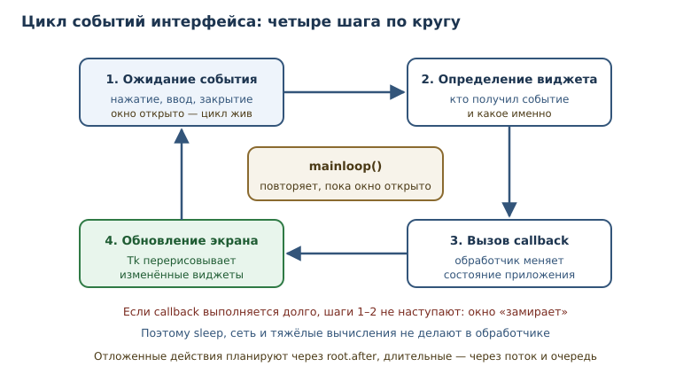
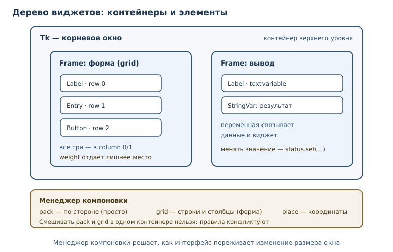

# Графический интерфейс на tkinter

<!-- syllanix:nav -->
**Навигация:** [← 54. Практикум: классические задачи и разбор решений](54-practice.md) · [Оглавление книги](../README.md) · [Далее: 56. Визуализация данных →](56-dataviz.md)
<!-- /syllanix:nav -->

<!-- syllanix:topics -->
**Темы главы**
55.1. [Что вы сможете после этой главы](#что-вы-сможете-после-этой-главы)  
55.2. [Зачем нужен GUI и когда он не нужен](#when)  
55.3. [Минимальное окно](#window)  
55.4. [Виджеты](#widgets)  
55.5. [Компоновка](#layout)  
55.6. [События и обработчики](#events)  
55.7. [Состояние приложения: модель отдельно от интерфейса](#model)  
55.8. [Пример: конвертер единиц](#converter)  
55.9. [Типичные ошибки](#mistakes)  
55.10. [Как тестировать GUI-логику без окна](#testing)  
55.11. [Упражнения](#упражнения)  
55.12. [Проверка понимания](#проверка-понимания)  
55.13. [Что дальше](#что-дальше)  
<!-- /syllanix:topics -->


До сих пор программы общались с человеком через терминал: напечатал команду —
получил строку. Это удобно для инструментов и автоматизации, но не для
приложений, которыми пользуются обычные люди. Им нужны окна, кнопки, поля
ввода и мгновенная реакция на действия.

**Приложение с графическим интерфейсом** — программа, которая
взаимодействует с человеком через окна, кнопки и другие элементы управления, а
не через терминал. В Python такой интерфейс можно собрать без установки
сторонних библиотек: **tkinter** входит в стандартную библиотеку. Это не самый
современный инструмент, зато доступный сразу, кроссплатформенный и достаточный
для учебных и служебных приложений.

## Что вы сможете после этой главы

К концу главы вы соберёте небольшое настольное приложение и поймёте, как оно
устроено внутри. Вы сможете:

- открывать окно и размещать в нём элементы управления;
- выбирать **виджет** под задачу и связывать его с данными;
- раскладывать интерфейс через **менеджер компоновки** и объяснять, как он
  ведёт себя при изменении размера окна;
- подписываться на события и писать **обработчик события (callback)**;
- отделять логику от интерфейса, чтобы её можно было тестировать без окна.

## Зачем нужен GUI и когда он не нужен {#when}

Графический интерфейс нужен, когда пользователь работает с программой
интерактивно и многократно: вводит данные, видит результат, меняет настройки.
Консоль остаётся лучше для автоматизации, скриптов и серверных задач: там нет
человека, который нажимает кнопки.

У tkinter есть сильные и слабые стороны. Он входит в стандартную библиотеку,
работает на Windows, macOS и Linux, не требует сборки и хорошо подходит для
прототипов, внутренних инструментов и учебных проектов. При этом внешний вид
зависит от системы, сложные анимации и современный дизайн делать неудобно, а
для больших интерфейсов чаще выбирают другие библиотеки. Для первой настольной
программы tkinter — разумный старт: те же идеи (виджеты, компоновка, события)
есть и в других фреймворках.

Отдельно стоит сказать про веб-интерфейсы: они удобны, когда программой
пользуются с разных устройств и её нужно обновлять централизованно. Настольное
приложение выигрывает, когда нужен доступ к локальным файлам, оборудованию или
работа без сети. Выбор между ними — вопрос условий эксплуатации, а не моды.

## Минимальное окно {#window}

Любая программа на tkinter начинается с корневого окна. Затем задаются
заголовок и размер, добавляются элементы, и запускается **цикл событий
интерфейса** — цикл, который ждёт действий пользователя и вызывает
зарегистрированные обработчики, пока окно открыто.

```python
import tkinter as tk

root = tk.Tk()
root.title("Первое окно")
root.geometry("320x200")
root.mainloop()
```

Разберём строки. `Tk()` создаёт корневое окно и связанный с ним интерпретатор
Tk. `title` задаёт заголовок, `geometry` — размер в пикселях. `mainloop`
передаёт управление циклу событий: программа не завершается, пока окно не
закрыто. Без `mainloop` окно может появиться на мгновение и исчезнуть —
типичная ошибка новичка.

```console
$ python app.py
```

Команда запускает приложение; окно открывается, и терминал «замирает», пока
цикл событий работает. Это нормально: программа ждёт действий пользователя, а
не бездействует.



## Виджеты {#widgets}

**Виджет** — элемент интерфейса: кнопка, поле ввода, метка, список, холст;
имеет состояние и реагирует на события. Все виджеты создаются как дочерние
элементы окна или контейнера и настраиваются параметрами.

| Виджет | Для чего |
|---|---|
| `Label` | показать текст или изображение |
| `Button` | выполнить действие по нажатию |
| `Entry` | ввести одну строку |
| `Text` | ввести и показать многострочный текст |
| `Listbox` | выбрать элемент из списка |
| `Checkbutton` | включить или выключить признак |
| `Radiobutton` | выбрать один вариант из нескольких |
| `Scale` | выбрать число ползунком |
| `Frame` | сгруппировать другие виджеты |

```python
import tkinter as tk

root = tk.Tk()
root.title("Витрина виджетов")

tk.Label(root, text="Введите имя:").pack(anchor="w")
name = tk.Entry(root)
name.pack(fill="x")

tk.Checkbutton(root, text="Запомнить меня").pack(anchor="w")
tk.Scale(root, from_=0, to=100, orient="horizontal").pack(fill="x")
tk.Text(root, height=3).pack(fill="both", expand=True)

listbox = tk.Listbox(root, height=4)
for item in ("первый", "второй", "третий"):
    listbox.insert("end", item)
listbox.pack(fill="both")

tk.Button(root, text="Готово", command=root.destroy).pack(pady=8)

root.mainloop()
```

Обратите внимание на `command=root.destroy`: кнопка закрывает окно и
завершает цикл событий. Это минимальный, но полноценный интерфейс.

### Списки и многострочный текст

`Listbox` хранит набор строк, а не отдельные виджеты. Элементы добавляют
методом `insert`, удаляют по индексу, а выбранный индекс получают через
`curselection`. Если нужен выбор нескольких элементов, включают
`selectmode="extended"`.

```python
listbox = tk.Listbox(root, selectmode="extended")
listbox.insert("end", "первая задача")
listbox.insert("end", "вторая задача")
selected = listbox.curselection()
for index in selected:
    print(listbox.get(index))
```

`Text` устроен сложнее: это не просто строка, а документ с индексами вида
`"1.0"` (строка и символ). Чтение всего содержимого — `text.get("1.0", "end-1c")`,
вставка — `text.insert("end", "новая запись")`. Индекс `end-1c` означает «конец
без последнего перевода строки», который Tk добавляет автоматически.

### Переменные интерфейса

Значения полей удобно хранить не в самом виджете, а в переменной Tkinter:
`StringVar`, `IntVar`, `BooleanVar`, `DoubleVar`. Виджет связывается с ней
через `textvariable`, а программа читает и меняет значение через переменную.

```python
status = tk.StringVar(value="готово")
tk.Label(root, textvariable=status).pack()
status.set("выполняется")
```

Такой подход разделяет данные и представление: логика работает со значениями,
а интерфейс сам обновляется при изменении переменной. Для полей ввода это
избавляет от ручного чтения `entry.get()` в каждом обработчике.

## Компоновка {#layout}

Создать виджет мало — нужно указать, где он находится. **Менеджер компоновки** —
механизм размещения виджетов в окне: `pack`, `grid`, `place`; определяет, как
интерфейс переживает изменение размера.

| Менеджер | Как работает | Когда удобен |
|---|---|---|
| `pack` | укладывает виджеты друг за другом по стороне | простые панели, вертикальные списки |
| `grid` | ставит в ячейки таблицы (строка, столбец) | формы, сетки кнопок, почти весь интерфейс |
| `place` | задаёт абсолютные координаты и размер | редкие случаи точного позиционирования |

`grid` обычно лучше: он описывает структуру, а не координаты. При изменении
размера окна ячейки растягиваются по правилам `weight`, а виджеты
прижимаются к краям через `sticky`.

```python
import tkinter as tk

root = tk.Tk()
root.title("Форма на grid")
root.columnconfigure(1, weight=1)

tk.Label(root, text="Имя:").grid(row=0, column=0, sticky="w", padx=8, pady=6)
tk.Entry(root).grid(row=0, column=1, sticky="ew", padx=8, pady=6)

tk.Label(root, text="Город:").grid(row=1, column=0, sticky="w", padx=8, pady=6)
tk.Entry(root).grid(row=1, column=1, sticky="ew", padx=8, pady=6)

tk.Button(root, text="Отправить").grid(row=2, column=0, columnspan=2, pady=10)

root.mainloop()
```

### Как grid переживает изменение размера

Правила растяжения задаются для строк и столбцов, а не для отдельных
виджетов. `columnconfigure(1, weight=1)` говорит: лишнее место отдаётся
второму столбцу, поэтому поля ввода растягиваются, а подписи остаются
компактными. Аналогично `rowconfigure` распределяет лишнюю высоту.

`sticky` управляет положением виджета внутри ячейки: `"w"` прижимает влево,
`"ew"` растягивает по горизонтали, `"nsew"` — по обеим осям. `padx` и `pady`
добавляют внешние отступы, а `ipadx` и `ipady` — внутренние. Без `weight`
окно при растяжении оставит всё содержимое в углу: свободное место просто не
распределяется.
`sticky="ew"` растягивает виджет по горизонтали, `columnspan=2` объединяет
ячейки. Смешивать `pack` и `grid` в одном контейнере нельзя: Tkinter не сможет
согласовать их правила — интерфейс зависнет или выдаст ошибку.



## События и обработчики {#events}

Интерфейс реагирует на события: нажатие кнопки, ввод текста, движение мыши,
закрытие окна. **Обработчик события (callback)** — функция, которую интерфейс
вызывает при событии; не должна блокировать цикл событий надолго.

Есть два способа подписки. `command` связывает действие с кнопкой или
командым виджетом и вызывает функцию без аргументов. `bind` подписывает на
конкретное событие и передаёт объект `event`.

```python
import tkinter as tk

root = tk.Tk()
root.title("События")

status = tk.StringVar(value="нажмите кнопку")


def on_click() -> None:
    status.set("кнопка нажата")


def on_key(event: tk.Event) -> None:
    status.set(f"нажата клавиша {event.keysym!r}")


tk.Label(root, textvariable=status).pack(padx=12, pady=8)
tk.Button(root, text="Нажми", command=on_click).pack(pady=4)
root.bind("<Key>", on_key)

root.mainloop()
```

У объекта события есть полезные поля: `widget` (кто получил событие), `char`
(введённый символ), `keysym` (имя клавиши), `x` и `y` (координаты указателя).
Через `bind` строят горячие клавиши, обработку `<Return>`, `<Escape>` и
движения мыши.

### Закрытие окна и диалоги

Когда пользователь нажимает крестик, Tk генерирует событие закрытия. Его
можно перехватить и, например, спросить подтверждение или сохранить данные:
`root.protocol("WM_DELETE_WINDOW", on_close)`. Обработчик сам решает, вызвать
ли `root.destroy()`.

Стандартная библиотека даёт готовые диалоги: `tkinter.messagebox` для
сообщений и подтверждений, `tkinter.filedialog` для выбора файлов,
`tkinter.simpledialog` для ввода значения. Они не требуют отдельных
зависимостей, но выглядят по-разному на разных системах.

```python
from tkinter import filedialog, messagebox


def choose_file() -> None:
    path = filedialog.askopenfilename(title="Выберите файл")
    if path:
        messagebox.showinfo("Выбрано", path)
```

Диалоги блокируют вызывающий код до ответа пользователя, но не цикл событий:
Tk продолжает обрабатывать события, пока окно диалога открыто.

### Правило: не блокировать цикл событий

Цикл событий однопоточный: пока выполняется обработчик, окно не перерисовывается
и не реагирует на ввод. Поэтому в обработчике нельзя делать долгие операции:
`time.sleep`, сетевые запросы, тяжёлые вычисления. Окно «зависнет» — не потому,
что программа сломалась, а потому, что цикл занят.

```python
# Плохо: окно замрёт на пять секунд
def on_slow_click() -> None:
    import time
    time.sleep(5)


# Лучше: отложенное действие через after
def on_click() -> None:
    status.set("подождите…")
    root.after(1000, lambda: status.set("готово"))
```

`root.after(мс, функция)` планирует вызов в цикле событий, не блокируя его.
Для длительной работы с сетью или файлами используют отдельный поток, но
виджеты обновляют только в главном потоке: Tkinter не потокобезопасен.
Рабочий шаблон — поток складывает результат в `queue.Queue`, а главный поток
периодически проверяет очередь через `after`.

## Состояние приложения: модель отдельно от интерфейса {#model}

Самая полезная привычка при работе с GUI — не смешивать правила предметной
области с кнопками. Модель ничего не знает про окна: это обычные функции и
классы, которые можно запустить и проверить в терминале. Интерфейс лишь
вызывает модель и показывает результат.

```python exec
KM_PER_MILE = 1.609344


def km_to_miles(kilometers: float) -> float:
    return kilometers / KM_PER_MILE


def miles_to_km(miles: float) -> float:
    return miles * KM_PER_MILE


def format_distance(value: float, digits: int = 2) -> str:
    return f"{value:.{digits}f}"


print(format_distance(km_to_miles(10)))
print(format_distance(miles_to_km(26.2), 1))

assert km_to_miles(0) == 0
assert round(km_to_miles(1.609344), 6) == 1
assert round(miles_to_km(1), 6) == 1.609344
assert format_distance(1.005, 2) == "1.00" or format_distance(1.005, 2) == "1.01"
print("тесты модели прошли")
```

```output
6.21
42.2
тесты модели прошли
```

Последняя проверка намеренно осторожна: поведение округления чисел с плавающей
точкой зависит от двоичного представления, и опираться на конкретную цифру в
учебном тесте не стоит. Проверять нужно то, что действительно входит в
контракт функции.

## Пример: конвертер единиц {#converter}

Соберём приложение целиком: поле ввода, переключатель направления, кнопка и
результат. Модель — уже написанные функции; интерфейс — тонкая оболочка.

```python
import tkinter as tk

KM_PER_MILE = 1.609344


def km_to_miles(kilometers: float) -> float:
    return kilometers / KM_PER_MILE


def miles_to_km(miles: float) -> float:
    return miles * KM_PER_MILE


def parse_distance(text: str) -> float:
    cleaned = text.strip().replace(",", ".")
    if not cleaned:
        raise ValueError("введите расстояние")
    try:
        value = float(cleaned)
    except ValueError as exc:
        raise ValueError(f"не число: {text!r}") from exc
    if value < 0:
        raise ValueError("расстояние не может быть отрицательным")
    return value


class ConverterApp:
    def __init__(self, root: tk.Tk) -> None:
        self.root = root
        self.mode = tk.StringVar(value="km_to_miles")
        self.input_text = tk.StringVar()
        self.result_text = tk.StringVar(value="—")

        tk.Label(root, text="Расстояние:").grid(row=0, column=0, sticky="w", padx=8, pady=6)
        tk.Entry(root, textvariable=self.input_text).grid(
            row=0, column=1, sticky="ew", padx=8, pady=6
        )

        tk.Radiobutton(
            root, text="километры → мили", variable=self.mode,
            value="km_to_miles",
        ).grid(row=1, column=0, sticky="w", padx=8)
        tk.Radiobutton(
            root, text="мили → километры", variable=self.mode,
            value="miles_to_km",
        ).grid(row=2, column=0, sticky="w", padx=8)

        tk.Button(root, text="Перевести", command=self.convert).grid(
            row=3, column=0, columnspan=2, pady=8
        )
        tk.Label(root, textvariable=self.result_text).grid(
            row=4, column=0, columnspan=2, pady=6
        )
        root.columnconfigure(1, weight=1)

    def convert(self) -> None:
        try:
            value = parse_distance(self.input_text.get())
        except ValueError as error:
            self.result_text.set(f"Ошибка: {error}")
            return
        if self.mode.get() == "km_to_miles":
            self.result_text.set(f"{km_to_miles(value):.2f} мили")
        else:
            self.result_text.set(f"{miles_to_km(value):.2f} км")


def main() -> None:
    root = tk.Tk()
    root.title("Конвертер расстояний")
    ConverterApp(root)
    root.mainloop()


if __name__ == "__main__":
    main()
```

Здесь важно всё, о чём говорилось выше: модель (`km_to_miles`, `parse_distance`)
не зависит от Tkinter и тестируется отдельно; `StringVar` связывает данные
с полями; `grid` задаёт форму; `command` подписывает кнопку на метод, а не на
голую функцию — так у обработчика есть доступ к состоянию приложения.
Проверка ошибок стоит в обработчике, потому что она относится к вводу
пользователя, а не к математике.

## Типичные ошибки {#mistakes}

1. **Не вызван `mainloop`.** Окно появляется и сразу исчезает; программа
   завершается, не дождавшись действий пользователя.
2. **Забыт менеджер компоновки.** Виджет создан, но не показан: без `pack`,
   `grid` или `place` он не попадает в окно.
3. **Смешаны `pack` и `grid` в одном контейнере.** Tkinter не может
   согласовать правила; интерфейс зависает или падает с ошибкой.
4. **Блокирующий обработчик.** `sleep`, долгий запрос или тяжёлый цикл в
   callback замораживают окно: цикл событий не может обработать следующий
   ввод.
5. **Работа с виджетами из другого потока.** Tkinter не потокобезопасен;
   обновлять интерфейс должен главный поток, а фоновый — передавать данные
   через очередь.
6. **Логика внутри обработчиков.** Когда правила предметной области размазаны
   по `command`-функциям, их нельзя протестировать и трудно менять.
7. **Абсолютные координаты через `place`.** Интерфейс ломается при другом
   размере шрифта или окна; `grid` и `pack` переживают изменения лучше.

## Как тестировать GUI-логику без окна {#testing}

Главный приём — вынести правила в чистые функции и классы, как в конвертере.
Тогда тесты не открывают окно и работают в обычном терминале.

```python exec
def parse_distance(text: str) -> float:
    cleaned = text.strip().replace(",", ".")
    if not cleaned:
        raise ValueError("введите расстояние")
    try:
        value = float(cleaned)
    except ValueError as exc:
        raise ValueError(f"не число: {text!r}") from exc
    if value < 0:
        raise ValueError("расстояние не может быть отрицательным")
    return value


for raw in ["10", " 2,5 ", "-1", "abc"]:
    try:
        print(repr(raw), "→", parse_distance(raw))
    except ValueError as error:
        print(repr(raw), "→ ошибка:", error)
```

```output
'10' → 10.0
' 2,5 ' → 2.5
'-1' → ошибка: расстояние не может быть отрицательным
'abc' → ошибка: не число: 'abc'
```

Если нужно проверить сам интерфейс, используют `root.update()` и проверяют
состояние виджетов без `mainloop`. Но такие тесты медленные и хрупкие; их
держат отдельно и в небольшом количестве. Основная масса проверок должна
относиться к модели.

Есть и практическая причина: на сервере без графической среды окно не
создаётся вовсе, и тест падает с ошибкой подключения к дисплею. Поэтому
GUI-тесты помечают и пропускают, если дисплей недоступен, а логику проверяют
всегда. Хороший признак архитектуры — возможность запустить 90 % тестов, не
открывая ни одного окна.

## Упражнения

### 1. Минимальное окно {#ex-ch55-01}

Напишите программу, которая открывает окно 400×300 с заголовком «Мой первый
GUI», добавляет метку «Привет» и кнопку «Закрыть», завершающую приложение.
Объясните, что произойдёт, если убрать `mainloop()`.

### 2. Витрина виджетов {#ex-ch55-02}

Создайте окно с `Label`, `Entry`, `Checkbutton` и `Button`. По нажатию кнопки
метка показывает текст из поля ввода. Опишите, какие параметры виджетов
понадобились и зачем.

### 3. Модель счётчика {#ex-ch55-03}

Реализуйте класс `CounterModel` с методами `increment()`, `decrement()` и
`reset()`. Значение не должно уходить ниже нуля. Проверьте поведение в
терминале, без окна.

### 4. Форма на grid {#ex-ch55-04}

Соберите форму «Имя — Email — Кнопка» через `grid`. Подписи прижаты к левому
краю, поля растягиваются. Объясните, что делает `columnconfigure` и
`sticky`.

### 5. Обработчик и событие {#ex-ch55-05}

Подпишите окно на событие `<Return>` и на нажатие кнопки. Оба обработчика
должны менять одну и ту же переменную `StringVar`. Опишите разницу между
`command` и `bind`.

### 6. Валидация ввода {#ex-ch55-06}

Реализуйте функцию `parse_percent(text: str) -> float`, которая принимает
число от 0 до 100, понимает запятую как разделитель и поднимает `ValueError`
с понятным сообщением для остальных случаев. Проверьте пять вариантов ввода.

### 7. Модель списка задач {#ex-ch55-07}

Реализуйте класс `TaskList` с методами `add(title)`, `toggle(index)` и
`visible()`. Пустой заголовок — ошибка; неверный индекс — `IndexError`.
Проверьте сценарий из трёх задач.

### 8. Не блокировать цикл {#ex-ch55-08}

Дан обработчик, который вызывает `time.sleep(3)` и обновляет метку.
Объясните, что увидит пользователь, и перепишите обработчик так, чтобы окно
не замирало. Используйте `after`.

### 9. Конвертер температуры {#ex-ch55-09}

Реализуйте чистые функции `celsius_to_fahrenheit` и `fahrenheit_to_celsius`,
а затем опишите, как подключить их к окну с полем ввода и переключателем.
Проверьте функции тестами, включая точку −40.

### 10. Мини-проект: приложение «Заметки» {#ex-ch55-10}

Спроектируйте приложение: поле ввода, кнопка «Добавить», список заметок и
кнопка «Удалить выбранную». Разделите модель и интерфейс: модель — класс с
методами `add`, `remove`, `items`; интерфейс — окно, виджеты и обработчики.
Реализуйте и протестируйте модель в терминале, а интерфейс опишите кодом в
неисполняемом блоке.

## Проверка понимания

1. Чем приложение с графическим интерфейсом отличается от консольной
   программы и когда каждое уместно?
2. Что делает `mainloop` и почему без него окно не живёт?
3. Чем `pack`, `grid` и `place` отличаются и почему `grid` чаще выбирают?
4. Чем `command` отличается от `bind`?
5. Почему долгий обработчик «подвешивает» окно и как этого избежать?
6. Зачем разделять модель и интерфейс?
7. Почему Tkinter нельзя обновлять из фонового потока и какой шаблон
   используют вместо этого?

## Что дальше

Настольное приложение готово, но данные в нём пока живут только в памяти.
Следующая глава — о визуализации данных: как превращать числа в понятные
графики и не обманывать читателя. О стандартной библиотеке говорилось в
[главе 34](34-stdlib.md), о файлах и сохранении данных — в
[главе 19](19-files-formats.md), о тестах модели — в
[главе 32](32-testing.md).

<!-- syllanix:nav -->
**Перед этой главой:** [54. Практикум: классические задачи и разбор решений](54-practice.md)
**Связанные главы:** [01. Зачем Python и как устроена эта книга](01-introduction.md), [03. Значения, имена, объекты и типы](03-values-names-objects.md), [06. Циклы: while и for](06-loops.md), [07. Функции: параметры, аргументы и области видимости](07-functions.md), [09. Модули, пакеты и импорты](09-modules.md), [10. Ошибки и исключения](10-errors-exceptions.md), [15. Строки: методы, форматирование и Unicode](15-strings.md), [25. Объекты и классы](25-objects-classes.md)
**Далее:** [56. Визуализация данных →](56-dataviz.md)
<!-- /syllanix:nav -->
