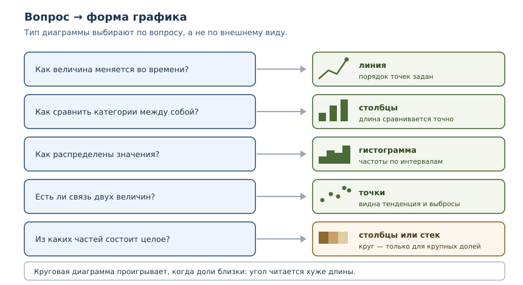
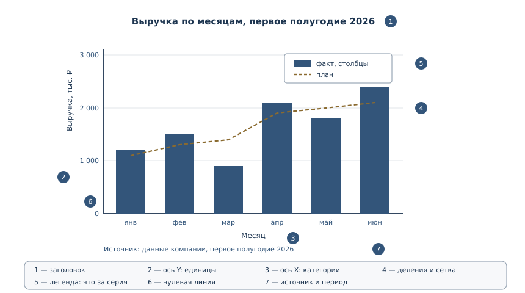

# Визуализация данных

<!-- syllanix:nav -->
**Навигация:** [← 55. Графический интерфейс на tkinter](55-tkinter.md) · [Оглавление книги](../README.md) · [Далее: Что дальше →](../afterword.md)
<!-- /syllanix:nav -->

<!-- syllanix:topics -->
**Темы главы**
56.1. [Что вы сможете после этой главы](#что-вы-сможете-после-этой-главы)  
56.2. [Зачем визуализация](#why)  
56.3. [Из чего состоит график](#anatomy)  
56.4. [Выбор типа диаграммы](#types)  
56.5. [matplotlib: фигура и оси](#matplotlib)  
56.6. [Четыре базовых графика](#plot-kinds)  
56.7. [Оси, подписи и легенда](#axes)  
56.8. [Честность графика](#honesty)  
56.9. [Практика: от данных к графику](#practice)  
56.10. [Экспорт рисунка](#export)  
56.11. [Когда лучше таблица](#table)  
56.12. [Типичные ошибки](#mistakes)  
56.13. [Упражнения](#упражнения)  
56.14. [Проверка понимания](#check)  
56.15. [Связи](#links)  
<!-- /syllanix:topics -->


Таблица с сотней чисел честна и почти бесполезна: закономерность в ней есть,
но увидеть её трудно. График показывает ту же информацию иначе — глаз сразу
замечает рост, провал, выброс или разброс. Визуализация не украшение отчёта, а
инструмент мышления: иногда именно она делает проблему очевидной. Эта глава о
том, как строить графики, которые не врут, и как выбирать форму под вопрос, а
не под привычку.

## Что вы сможете после этой главы

К концу главы вы сможете делать следующее.

- выбирать тип диаграммы под вопрос: динамика, сравнение, распределение,
  связь, части целого;
- объяснять анатомию графика: данные, оси, единицы, подписи, легенда,
  источник;
- строить графики через `matplotlib` с объектной моделью `Figure`/`Axes`;
- замечать нечестные графики: обрезанную шкалу, неуказанные единицы,
  сравнение несравнимого, путаницу корреляции с причинностью;
- готовить данные для графика отдельно от рисования и проверять эту
  подготовку тестами;
- экспортировать рисунок в PNG или SVG с нужным разрешением.

## Зачем визуализация {#why}

**Визуализация данных** — представление данных графиком или диаграммой, чтобы
читатель увидел закономерность быстрее, чем в таблице. У глаза есть сильная
сторона: он мгновенно сравнивает длины, положения и наклоны. У таблицы —
другая: она хранит точные значения. Хороший отчёт использует обе.

График решает четыре задачи.

1. **Динамика.** Как менялась величина во времени: росла, падала, колебалась.
2. **Сравнение.** Какая категория больше и насколько.
3. **Распределение.** Где центр значений и насколько велик разброс; есть ли
   выбросы.
4. **Связь.** Меняются ли две величины согласованно.

Есть и пятая задача — части целого, но с ней чаще всего ошибаются, поэтому о
ней отдельно.



## Из чего состоит график {#anatomy}

График — это не картинка, а утверждение о данных. У него есть обязательные
части, без которых утверждение становится двусмысленным.

- **Данные.** Что именно изображено: одна серия или несколько, за какой
  период, в каких единицах.
- **Тип диаграммы.** Форма, соответствующая вопросу.
- **Оси.** Горизонтальная и вертикальная, с подписями и единицами измерения.
- **Деления и диапазон.** Откуда начинается шкала и какой шаг между делениями.
- **Заголовок.** Что и за какой период показано.
- **Легенда.** Что означает каждая серия, если их несколько.
- **Источник.** Откуда данные и когда они собраны.



Пропущенная часть почти всегда превращается в вопрос читателя. Нет единиц —
непонятно, рубли это или тысячи рублей. Нет периода — непонятно, к чему
относятся числа. Нет источника — невозможно проверить.

## Выбор типа диаграммы {#types}

**Типы диаграмм** — формы представления данных, каждая из которых отвечает на
свой вопрос. Выбор делают по вопросу, а не по внешнему виду.

| Вопрос | Тип | Почему |
|---|---|---|
| как меняется во времени | линия | порядок точек задан, важна форма изменения |
| как сравнить категории | столбцы | длина столбца сравнивается точно |
| как распределены значения | гистограмма | показывает частоты по интервалам |
| насколько велик разброс | ящик с усами | видны медиана, квартили и выбросы |
| есть ли связь двух величин | точки | видна общая тенденция и выбросы |
| из каких частей состоит целое | столбцы или стек | доли читаются точнее, чем сектора |

Круговая диаграмма — частая ошибка начинающих. Угол сектора человек сравнивает
хуже, чем длину, а при близких долях разница вообще не видна. Если доли почти
равны, круговая диаграмма создаёт ложное впечатление одинаковости.

```python exec
shares = {"A": 27, "B": 25, "C": 24, "D": 24}
total = sum(shares.values())
percent = {name: round(value * 100 / total, 1) for name, value in shares.items()}
print("доли, %:", percent)
print("разница между максимумом и минимумом:", round(max(percent.values()) - min(percent.values()), 1), "п.п.")
```

```output
доли, %: {'A': 27.0, 'B': 25.0, 'C': 24.0, 'D': 24.0}
разница между максимумом и минимумом: 3.0 п.п.
```

Разница три процентных пункта: на глаз сектора почти неотличимы, а столбцы с
подписанными значениями покажут её честно.

## matplotlib: фигура и оси {#matplotlib}

**matplotlib** — библиотека построения графиков для Python: фигуры, оси,
линии, столбцы, подписи и сохранение в файл. Она не входит в стандартную
библиотеку, поэтому её устанавливают как зависимость проекта:

```console
$ uv add matplotlib
```

Внутри matplotlib есть две модели работы. Простая, через `pyplot`, действует
на «текущую фигуру» и удобна для быстрых экспериментов. Основная, объектная,
работает с явными объектами: `Figure` — весь рисунок, `Axes` — область с
осями и данными. Для кода, который живёт дольше одного скрипта, используют
вторую: она предсказуема, потому что не зависит от глобального состояния.

```python
import matplotlib.pyplot as plt

months = ["янв", "фев", "мар", "апр", "май", "июн"]
revenue = [1200, 1500, 900, 2100, 1800, 2400]

fig, ax = plt.subplots(figsize=(8, 4.5))
ax.plot(months, revenue, marker="o", linewidth=2, color="#33557a")
ax.set_title("Выручка по месяцам, первое полугодие 2026")
ax.set_xlabel("Месяц")
ax.set_ylabel("Выручка, тыс. ₽")
ax.set_ylim(bottom=0)
ax.grid(True, axis="y", alpha=0.3)
fig.tight_layout()
fig.savefig("revenue.png", dpi=150, bbox_inches="tight")
```

Разберём строки. `plt.subplots()` возвращает фигуру и оси; `ax.plot` рисует
линию с маркерами; `set_*` задают подписи и диапазон; `grid` добавляет сетку
по горизонтали; `tight_layout` убирает обрезанные подписи; `savefig`
сохраняет результат. Обратите внимание на `set_ylim(bottom=0)`: для столбцов
и площадей нулевая линия обязательна, иначе длины искажаются.

## Четыре базовых графика {#plot-kinds}

Одни и те же данные можно показать по-разному, и форма должна отвечать на
вопрос. Ниже — четыре типовых случая.

### Столбцы: сравнение категорий

```python
fig, ax = plt.subplots(figsize=(8, 4.5))
ax.bar(months, revenue, color="#33557a")
ax.set_title("Выручка по месяцам")
ax.set_ylabel("Выручка, тыс. ₽")
ax.set_xlabel("Месяц")
ax.set_ylim(bottom=0)
for index, value in enumerate(revenue):
    ax.text(index, value + 40, f"{value}", ha="center", fontsize=9)
fig.tight_layout()
```

Подписи значений над столбцами избавляют читателя от необходимости оценивать
высоту на глаз — для небольших наборов данных это хорошая практика.

### Гистограмма: распределение

```python
durations = [12, 15, 18, 18, 21, 24, 24, 27, 30, 35, 41, 44, 47, 52]

fig, ax = plt.subplots(figsize=(8, 4.5))
ax.hist(durations, bins=range(0, 61, 10), edgecolor="white")
ax.set_title("Распределение времени доставки")
ax.set_xlabel("Время, мин")
ax.set_ylabel("Число заказов")
fig.tight_layout()
```

Гистограмма показывает, как значения распределены по интервалам. Это не
столбцы сравнения категорий: интервалы упорядочены, а высота означает частоту.
Число интервалов влияет на вид — слишком крупные скрывают структуру, слишком
мелкие показывают шум.

Посчитаем частоты без matplotlib, чтобы проверить данные до рисования.

```python exec
values = [12, 15, 18, 18, 21, 24, 24, 27, 30, 35, 41, 44, 47, 52]

def histogram(items, width):
    bins = {}
    for value in items:
        start = value // width * width
        bins[start] = bins.get(start, 0) + 1
    return sorted(bins.items())

print("границы и частоты:", histogram(values, 10))
print("всего значений:", len(values))
```

```output
границы и частоты: [(10, 4), (20, 4), (30, 2), (40, 3), (50, 1)]
всего значений: 14
```

### Точечный график: связь величин

```python
hours = [2, 3, 4, 5, 6]
scores = [60, 65, 70, 68, 75]

fig, ax = plt.subplots(figsize=(6, 4.5))
ax.scatter(hours, scores, s=60, alpha=0.8)
ax.set_title("Подготовка и результат")
ax.set_xlabel("Часы подготовки")
ax.set_ylabel("Баллы")
fig.tight_layout()
```

Точки показывают пары значений. По ним видна общая тенденция, разброс и
отдельные выбросы — но не доказательство причины: связь двух величин сама по
себе ничего не говорит о том, что одна вызывает другую.

### Линия с двумя сериями и легендой

```python
fact = [1200, 1500, 900, 2100, 1800, 2400]
plan = [1100, 1300, 1400, 1900, 2000, 2100]

fig, ax = plt.subplots(figsize=(9, 4.5))
ax.plot(months, fact, marker="o", label="Факт")
ax.plot(months, plan, marker="s", linestyle="--", label="План")
ax.set_title("Факт и план по месяцам")
ax.set_xlabel("Месяц")
ax.set_ylabel("Выручка, тыс. ₽")
ax.set_ylim(bottom=0)
ax.legend(title="Серия", loc="upper left")
ax.grid(True, axis="y", alpha=0.3)
fig.tight_layout()
```

Две серии на одном графике сравнимы, только если это одни и те же единицы и
один и тот же период. Легенда обязательна: без неё читатель не знает, какая
линия что означает.

## Оси, подписи и легенда {#axes}

**Оси и подписи графика** — подписи осей, единицы, заголовок, легенда, диапазон
и деления. Без них график вводит в заблуждение, даже если данные верны.

Правила, которые закрывают большинство проблем.

1. **Единицы в подписи оси.** «Выручка, тыс. ₽» лучше, чем «Выручка».
2. **Диапазон оси осознан.** Для столбцов нижняя граница — ноль. Для линий
   можно начать выше нуля, если это явно видно на шкале.
3. **Заголовок отвечает на вопрос.** «Выручка по месяцам, первое полугодие
   2026» лучше, чем «График».
4. **Легенда только при нескольких сериях.** Одна серия объясняется подписью
   оси.
5. **Деления читаемы.** Десять делений на сантиметр — шум; три-пять —
   ориентир.
6. **Источник и период.** Кто и когда собрал данные.

Данные для графика удобно готовить отдельно от рисования. Тогда подготовку
можно проверить тестом, а рисование заменить или убрать.

```python exec
rows = [
    {"month": "янв", "revenue": 1200},
    {"month": "фев", "revenue": 1500},
    {"month": "мар", "revenue": 900},
]

def monthly_series(rows):
    return [row["month"] for row in rows], [row["revenue"] for row in rows]

months, revenue = monthly_series(rows)
print("подписи:", months)
print("значения:", revenue)
print("длины совпадают:", len(months) == len(revenue))
```

```output
подписи: ['янв', 'фев', 'мар']
значения: [1200, 1500, 900]
длины совпадают: True
```

Функция `monthly_series` ничего не знает о matplotlib: она превращает данные в
две последовательности. Тест проверяет её без установки библиотеки, а
рисование получает готовые списки.

## Честность графика {#honesty}

**Честность графика** — отсутствие искажений: подходящий диапазон оси, честное
сравнение, указание источника и неопределённости. График может быть
формально правильным и при этом создавать ложное впечатление — это и есть
нечестная визуализация.

Посмотрим, как обрезанная шкала меняет восприятие. Три магазина с выручкой
98, 100 и 103 тыс. ₽ выглядят почти одинаково, но если начать ось с 95,
разница превращается в «в разы».

```python exec
values = [98, 100, 103]
baseline = 95
heights = [value - baseline for value in values]
print("фактические значения:", values)
print("высоты при базе 0:", values)
print("высоты при базе 95:", heights)
print("отношение значений:", round(values[2] / values[0], 3))
print("отношение высот при базе 95:", round(heights[2] / heights[0], 1))
```

```output
фактические значения: [98, 100, 103]
высоты при базе 0: [98, 100, 103]
высоты при базе 95: [3, 5, 8]
отношение значений: 1.051
отношение высот при базе 95: 2.7
```

Значения отличаются на 5 %, а столбцы при обрезанной оси — в 2,7 раза. Для
столбцов длина кодирует величину, поэтому нулевая линия обязательна.

Другие распространённые искажения:

- **Двойная ось Y.** Две шкалы на одном графике позволяют подогнать любую
  «впечатляющую» корреляцию; без сильной причины так делать не стоит.
- **Трёхмерные диаграммы.** Перспектива искажает длины и площади.
- **Круговая диаграмма с близкими долями.** Сектора неразличимы, а сумма
  должна быть 100 %.
- **Выбранный период.** Можно показать «рост» за удачные месяцы, скрыв
  предыдущий спад.
- **Среднее без разброса.** Одно число скрывает, что половина значений сильно
  отличается от него.
- **Корреляция как причина.** Согласованный рост двух величин не доказывает,
  что одна вызвала другую.

## Практика: от данных к графику {#practice}

Разделим работу на три шага: прочитать данные, агрегировать, нарисовать. Так
каждый шаг проверяется отдельно, а рисование можно заменить.

### Шаг 1. Прочитать CSV

Читаем строки как записи с именованными полями и сразу приводим числа к `int`:
дальше с ними работают как со значениями, а не как с текстом.

```python exec
import csv
import io

raw = """month,revenue
2026-01,1200
2026-02,1500
2026-03,900
2026-04,2100
2026-05,1800
2026-06,2400
"""
reader = csv.DictReader(io.StringIO(raw))
rows = [{"month": row["month"], "revenue": int(row["revenue"])} for row in reader]
print("месяцев:", len(rows))
print("выручка:", [row["revenue"] for row in rows])
best = max(rows, key=lambda row: row["revenue"])
print("лучший месяц:", best["month"], best["revenue"])
print("рост к январю:", round(rows[-1]["revenue"] / rows[0]["revenue"], 2))
```

```output
месяцев: 6
выручка: [1200, 1500, 900, 2100, 1800, 2400]
лучший месяц: 2026-06 2400
рост к январю: 2.0
```

### Шаг 2. Агрегировать и упорядочить

Часто перед графиком нужно посчитать итоги по категориям и отсортировать их —
столбцы читаются лучше, когда упорядочены.

```python exec
totals = {"март": 900, "январь": 1200, "февраль": 1500}
ordered = sorted(totals.items(), key=lambda item: item[1], reverse=True)
print("по убыванию:", [name for name, value in ordered])
print("значения:", [value for name, value in ordered])
```

```output
по убыванию: ['февраль', 'январь', 'март']
значения: [1500, 1200, 900]
```

### Шаг 3. Нарисовать

Рисование получает готовые списки и не занимается ни чтением файлов, ни
сортировкой — только оформлением.

```python
titles = ["февраль", "январь", "март"]
values = [1500, 1200, 900]

fig, ax = plt.subplots(figsize=(6, 4))
ax.bar(titles, values, color="#33557a")
ax.set_title("Выручка по месяцам, тыс. ₽")
ax.set_ylabel("Выручка, тыс. ₽")
ax.set_ylim(bottom=0)
fig.tight_layout()
fig.savefig("monthly.svg")
```

Данные можно брать и из JSON — например, если описание графика приходит из
конфигурации отчёта.

```python exec
import json

raw = '{"title": "Выручка по месяцам", "x": ["янв", "фев", "мар"], "series": [{"name": "факт", "values": [1200, 1500, 900]}, {"name": "план", "values": [1100, 1300, 1400]}]}'
spec = json.loads(raw)
print("заголовок:", spec["title"])
print("категорий:", len(spec["x"]))
print("серий:", len(spec["series"]))
for series in spec["series"]:
    print(series["name"], sum(series["values"]))
```

```output
заголовок: Выручка по месяцам
категорий: 3
серий: 2
факт 3600
план 3800
```

Рисование по такому описанию — один цикл по сериям:

```python
import json
import matplotlib.pyplot as plt

spec = json.loads(open("chart.json", encoding="utf-8").read())

fig, ax = plt.subplots(figsize=(8, 4.5))
for series in spec["series"]:
    ax.plot(spec["x"], series["values"], marker="o", label=series["name"])
ax.set_title(spec["title"])
ax.set_xlabel("Месяц")
ax.set_ylabel("Выручка, тыс. ₽")
ax.set_ylim(bottom=0)
ax.legend(title="Серия")
fig.tight_layout()
fig.savefig("chart.png", dpi=150, bbox_inches="tight")
```

## Экспорт рисунка {#export}

**Экспорт рисунка** — сохранение графика в файл с достаточным разрешением и
встраивание в документ или презентацию. Формат выбирают по назначению.

| Формат | Когда подходит | Что важно |
|---|---|---|
| PNG | презентации, веб, скриншоты | разрешение `dpi`, размер в пикселях |
| SVG | отчёты, документы, масштабирование | векторный, текст остаётся текстом |
| PDF | печать и публикация | векторный, встраивается в PDF-отчёт |

Практические параметры:

```python
fig.savefig("chart.png", dpi=300, bbox_inches="tight")   # печать
fig.savefig("chart.svg")                                 # масштабирование без потерь
```

`dpi` задаёт число точек на дюйм: 150 достаточно для экрана, 300 — для печати.
`bbox_inches="tight"` убирает лишние поля и обрезанные подписи. Для отчётов
формат SVG предпочтительнее: он остаётся чётким при любом масштабе, а текст в
нём можно выделить. Для слайдов и мессенджеров удобнее PNG, потому что он
открывается везде.

## Когда лучше таблица {#table}

График не всегда лучше таблицы. Таблица выигрывает, когда:

- значений мало (пять-десять) и нужны точные числа;
- читатель будет искать конкретное значение, а не сравнивать форму;
- важна доступность: таблицу читают программы экранного доступа;
- данные нужно скопировать или проверить;
- значения несопоставимы по природе, и общая шкала введёт в заблуждение.

Хороший отчёт часто содержит и график, и таблицу: график показывает
закономерность, таблица даёт точные значения для проверки.

## Типичные ошибки {#mistakes}

1. **Обрезанная ось у столбцов.** Длины перестают быть пропорциональны
   значениям, и разница выглядит драматичнее, чем есть.
2. **Нет единиц измерения.** «Выручка» без «тыс. ₽» читается неверно.
3. **Нет периода и источника.** График невозможно ни понять, ни проверить.
4. **Круговая диаграмма для близких долей.** Сектора неразличимы, сравнение
   невозможно.
5. **Две серии в разных единицах на одной оси.** Сравнение бессмысленно;
   нужны две оси с явной оговоркой или два графика.
6. **Гистограмма вместо столбцов.** Гистограмма показывает распределение, а
   не сравнение категорий.
7. **Корреляция как причина.** Согласованный рост не доказывает влияние.
8. **Рисование без проверки данных.** Ошибка в агрегации попадёт на график и
   станет убедительной картинкой.
9. **Слишком много линий на одном графике.** Больше трёх-четырёх серий глаз
   не различает; лучше несколько графиков.

## Упражнения

### 1. Вопрос и форма {#ex-ch56-01}

Для каждого вопроса выберите тип диаграммы и объясните: (а) как менялась
посещаемость по неделям; (б) сколько студентов в каждой из пяти групп; (в)
как распределены оценки за экзамен; (г) связаны ли часы подготовки и балл;
(д) какую долю бюджета занимает каждая из четырёх статей.

### 2. Анатомия графика {#ex-ch56-02}

Дан график без подписей: по оси Y числа от 0 до 3000, по оси X шесть
категорий, две линии. Перечислите, каких элементов не хватает, и объясните,
какой вопрос возникнет у читателя из-за каждого пропуска.

### 3. Подготовка данных {#ex-ch56-03}

Дан список строк вида `"2026-03,1200"`. Напишите функцию, которая возвращает
два списка: месяцы и значения. Проверьте, что длины совпадают и что значения
преобразованы в `int`. Библиотеку matplotlib не используйте.

### 4. Обрезанная шкала {#ex-ch56-04}

Значения: 240, 250, 260. Постройте мысленно два варианта столбцов: с нулевой
линией и с нижней границей 230. Во сколько раз визуально отличаются крайние
столбцы в каждом варианте? Объясните, какой вариант честнее и почему.

### 5. Гистограмма {#ex-ch56-05}

Дан список времён доставки: 12, 15, 18, 18, 21, 24, 24, 27, 30, 35, 41, 44,
47, 52. Посчитайте частоты для интервалов по 10 минут без matplotlib и
объясните, как изменится вид гистограммы при интервале 5 минут.

### 6. Две серии {#ex-ch56-06}

Даны фактические значения по месяцам и план. Напишите функцию, которая
возвращает список отклонений «факт минус план» и список процентов выполнения
плана. Объясните, почему для графика достаточно первого списка, а для
отчёта — второго.

### 7. Честность {#ex-ch56-07}

Найдите три ошибки в описании графика: «График показывает, что выручка выросла
на 300 % за месяц; ось Y начинается с 950; данные за март; единицы не
указаны; вторая линия — количество сотрудников». Что нужно исправить?

### 8. Корреляция и причина {#ex-ch56-08}

Данные показывают, что продажи мороженого и число утоплений растут
одновременно. Сформулируйте два объяснения, при которых одна величина не
служит причиной другой, и предложите, какие данные помогли бы разобраться.

### 9. Экспорт {#ex-ch56-09}

Вам нужно вставить график в PDF-отчёт и в презентацию. Какой формат выбрать
для каждого случая и какие параметры указать? Объясните разницу между
растровым и векторным форматами.

### 10. Мини-задача: отчёт по месяцам {#ex-ch56-10}

Дан CSV с колонками `month,revenue,plan`. Напишите конвейер: прочитать данные,
посчитать отклонение от плана, упорядочить месяцы по времени, подготовить две
серии для графика. Нарисуйте линию факта и пунктир плана, добавьте заголовок,
подписи осей с единицами, легенду и нулевую линию. Сохраните в PNG и SVG.

## Проверка понимания {#check}

1. Какие четыре задачи решает график и как им соответствуют типы диаграмм?
2. Перечислите обязательные элементы графика и объясните, что произойдёт при
   пропуске каждого.
3. Почему для столбцов нулевая линия обязательна, а для линий — нет?
4. Чем объектная модель `Figure`/`Axes` удобнее `pyplot`?
5. Почему данные для графика стоит готовить отдельной функцией?
6. В чём разница между PNG и SVG и когда что выбирать?
7. Когда таблица лучше графика?
8. Почему корреляция не доказывает причинность и как это влияет на подписи
   графика?

## Связи {#links}

Глава опирается на работу с коллекциями из глав 12–18, на чтение CSV и JSON из
главы 19 и на управление зависимостями из главы 33: matplotlib — сторонняя
библиотека, поэтому её установку и версии фиксируют так же, как любую другую
зависимость. Сортировка и ключи из главы 23 нужны для упорядочивания
категорий, а функции из главы 7 — для отделения подготовки данных от
рисования. Интерфейс на tkinter из главы 55 показывает, как встроить график в
окно приложения.

Глава завершает книгу: после неё остаются проекты из глав 46–48 и
самостоятельная практика. Визуализация соединяет три вещи, которые книга
разбирала по отдельности: данные, код и читателя. График, который честно
показывает закономерность и не скрывает ограничений, — такой же результат
инженерной работы, как тесты и понятный интерфейс.

<!-- syllanix:nav -->
**Перед этой главой:** [55. Графический интерфейс на tkinter](55-tkinter.md)
**Связанные главы:** [07. Функции: параметры, аргументы и области видимости](07-functions.md), [12. Коллекции и последовательности: введение](12-collections-intro.md), [17. Словари: отображения и структурирование данных](17-dicts.md), [19. Файлы, пути и текстовые форматы](19-files-formats.md), [23. Функциональные приёмы и включения](23-functional.md), [33. Структура проекта, зависимости и инструменты](33-project-tooling.md)
**Далее:** [Что дальше →](../afterword.md)
<!-- /syllanix:nav -->
